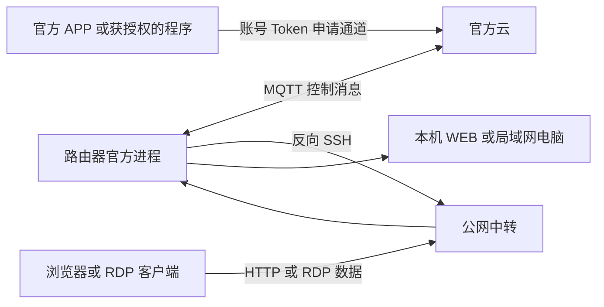

# 官方通道核对与独立上报方案

更新：2026-10-09。本文记录实际设备和接口验证，官方云与独立 HUB 并行运行。

## 已验证的结果

官方账号密码接口可供独立程序登录。取得 Bearer Token 后，账号信息、项目列表、设备列表、Token 刷新均成功；刷新后的 Token 也可继续查询。

| 官方项目 | 官方项目 ID | 已通过官方设备列表核对的 SN |
| --- | --- | --- |
| BE72-PRO(行者) | 18850348 | G1TD8RX039025 |
| BE50 | 17953001 | G1TQ88T702111 |

项目列表的 `buildingId` 是项目标识，`mainApSn` 本次返回空值。随后调用设备列表并传入 `projectId` 和当天 `day=YYYY-MM-DD`，成功取得两台路由器的 SN。只传项目 ID 会返回 `day is null!`。

独立程序已通过该账号的 Token 成功调用：

| 操作 | 官方接口 | 实测结果 |
| --- | --- | --- |
| 申请 WEB 通道 | `/homewlan/homeAp/getTunnelUrl` | 成功，返回带 `pass`、`stamp` 参数的访问地址 |
| 检查远程桌面 | `/homewlan/remoteAccess/checkStaRdp` | 接口成功 |
| 申请 RDP 通道 | `/homewlan/remoteAccess/getRdpTunnel` | 成功，返回临时 IP、端口、建立时间 |

在路由器进程中核对到了与这次返回端口一致的反向 SSH 转发：WEB 目标为 `127.0.0.1:80`，RDP 目标为 `192.168.5.201:3389`。通过申请的 RDP 公网端口收到 19 字节有效 TPKT/RDP 协商响应。尚未登录 Windows 桌面。

ADB 已确认官方 APP 的远程设备列表和用户建立通道的成功页面，并保存截图。API 独立申请成功是另一组验证；不能用截图代替 API 结果。

## 数据和通道如何工作

路由器官方 `shinya_mqlink.elf` 持续连接 TLS MQTT；本次查看到 `sy-mqtt01.ruijie.com.cn:11883`、60 秒 keepalive。另有 MACC 连接进程。终端日志上传周期为 60 秒，无线日志配置为 300 秒。各类日志与实时请求的频率不同，不能把日志周期当作整个 APP 的实时刷新周期。

通道申请和设备指令属于控制消息；已验证的 WEB/RDP 数据由反向 SSH 转发。并非把远程桌面画面持续塞进遥测消息队列。

## 需要哪种鉴权

- 官方云的通道申请接口：无 Token 测试返回 HTTP 401。使用获授权账号 Token 后成功。
- WEB：官方访问地址带自动登录参数，应按临时凭据处理。额外只读测试中，BE72 的 `sysinfo` 查询在不带 Cookie、SID、Token 时仍成功；BE50 同样查询返回 HTTP 403。该结果只适用于已测试的只读模块，不能推导所有接口和写操作都免鉴权。
- RDP：公网转发端口能完成协议协商，实际桌面登录仍由 Windows 账号密码控制。
- 路由器 MQTT 设备身份、APP 账号 Token、浏览器 MACC 会话是不同凭据。未验证 MACC 网页 Cookie 可作为 APP Token。

因此，官方 Token 可以在官方服务存续时供我们的程序调用已授权接口；官方项目 ID 可以保留为关联标识。HUB 必须使用自己的登录凭据并校验租户、项目、设备权限。官方 Token 失效后重新授权，官方服务停止后不能继续依靠这些接口。设备上报使用独立设备凭据。

当前 HUB 项目 ID 和历史数据保持原登记方式，不通过直接改数据库主键迁移。接入官方项目时先建立外部 ID 对应关系，并以设备 SN 核验，项目名称不作为身份依据。

## 已部署的独立上报

NAS 已部署 `shinya-hub:oct09-mqtt-v15`、独立 MQTT Broker 和接收进程。路由器仅运行独立采集程序；官方连接仍在运行。

| 数据 | 当前采集周期 |
| --- | --- |
| 终端列表、上下行速率 | 约 5 秒 |
| 路由器运行状态 | 约 15 秒 |
| 无线状态 | 约 30 秒 |
| 设备身份、AP 列表 | 约 60 秒 |

已有固件的持续发布客户端曾出现管道阻塞。当前原型改用 RAM 中的最新快照和有 8 秒超时的单次 MQTT 发布：新状态覆盖尚未发出的旧状态，采集不等待网络。此版本路由器端使用短连接，NAS 接收端保持长连接；后续应采用经固件兼容验证的稳定长连接客户端减少 TLS 握手。

服务端按设备合并待处理状态、并行解析、一次事务提交一帧、按运行标识和序列号去重。每台设备有独立 Topic 权限，租户和项目绑定由服务端决定。设备失败不清空已有缓存。新鲜上报抑制重复读取，过期后按模块回退已有 eWeb 采集。

最终回查：BE72 序列 474、BE50 序列 465，数据年龄约 6.31/5.33 秒；当前原生终端列表分别 10/8 台，保留历史设备分别 33/32 台。两个项目均有今日速率曲线与 8 维本地观察评分。评分不代表已复刻官方算法。独立 Broker 重启测试中，两台真实设备在 11.37 秒内恢复更新。

## 50 个用户、约 100 台路由器的容量

在 NAS 的隔离测试数据库中模拟 50 个租户、100 个项目、100 台路由器，每台 30 个终端，连续三轮共 300 帧：无写入失败。每轮集中更新耗时 1.736～2.294 秒，总处理吞吐 48.3 帧/秒，单帧处理 P95 为 645.69 毫秒。

完整合成帧平均 21,790 字节。如果 100 台均每 5 秒上传这样的完整帧，业务载荷约为：

`100 × 21,790 × 8 ÷ 5 = 3.49 Mbps`

这主要是 HUB 入站；20M 出站套餐需另外计算 APP 推送、历史查询和远程通道流量，云厂商也可能分别限制入站与出站。实际分周期采集的帧大小会变化。错峰能够降低峰值，不能降低相同上传周期的长期平均流量。

当前验证为数据库接收性能，并非 100 个真实 TLS 客户端或 50 个同时在线 APP 的网络压测。短连接 TLS、协议开销、并发远程桌面和 WEB 下载未计入 3.49 Mbps。不能据此承诺 20M 在所有组合负载下足够。

建议 APP 打开项目时提高所看项目的更新频率，后台只接收低频状态与事件，APP 首屏先显示缓存；远程通道按需建立并独立限速。此版本尚未实现按 APP 前后台自动调节采集周期，也未实现历史数据保留期限。

## 可复核证据

证据目录：`D:/Github/LabProbeApp/test/_analysis/oct08-shinya-hub/`。

- `cloud-sync/official-account-check.json`：账号、项目与通道接口结果；不含 Token、自动登录参数值。
- `cloud-sync/be72-reverse-direct-api.json`：独立 API 申请后的实际转发目标。
- `cloud-sync/rdp-direct-api-port-check.json`：RDP 协商结果。
- `cloud-sync/be72-eweb-noauth.json`、`be50-eweb-noauth.json`：只读鉴权差异。
- `cloud-sync/independent-sync-latest.json`：独立服务与实时数据回查。
- `cloud-sync/broker-recovery.json`：实际设备断开恢复。
- `cloud-sync/load-100-routers.json`：合成接收测试。
- `ui-audit/official-desktop-tunnel-user-success.png`：用户在官方 APP 建立通道的成功页面。

Token 仅保存在本地被 Git 忽略的加密测试会话中。该会话用于联调，尚未成为 HUB 的正式官方账号连接功能。49 项后台测试已通过；保留页面逐项 ADB 操作、手机 ARM64 安装、信号工具和户型模拟仍需继续验收。
